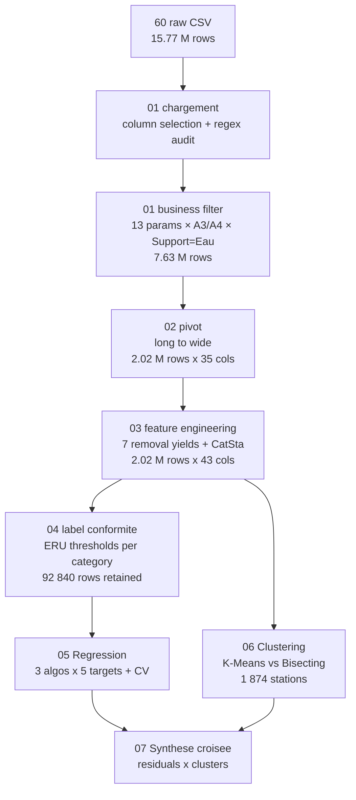

# HydraML: PySpark + MLlib pipeline on 5 years of French wastewater treatment plant data.


## What this project does

Takes 15.7 million rows of regulatory self-monitoring measurements from the Agence de l'eau Seine-Normandie (2018–2022), cleans them, and runs two ML tasks on them:


Two problems are addressed:

1. **Supervised regression** — predict the removal yield (%) of 5 pollutants from the input load and station characteristics.
2. **Unsupervised clustering** — segment the station fleet into homogeneous performance profiles.

A third notebook (`07_Synthese_Croisee`) crosses the two to test whether stations identified as atypical by clustering are also the ones the regression predicts worst.

Then crosses the two to see if the stations the clustering flags as problematic are also the ones the regression predicts worst.

## Stack

Python 3.10, PySpark 3, Spark MLlib, pandas, numpy, matplotlib, Jupyter, Parquet, Cookiecutter Data Science v1.

# In Nutshell
## data

- Source: data.gouv.fr, Agence de l'eau Seine-Normandie
- Period: January 2018 – December 2022
- 60 monthly CSV files, SANDRE format
- 15,775,181 raw rows, 2,005 stations, 27 departments

## Pipeline

```
raw CSV (15.7M rows)
    -> 01 ingestion + quality audit + business filter       -> 7.6M rows
    -> 02 pivot long to wide                                 -> 2.0M rows x 35 cols
    -> 03 feature engineering (7 removal yields + CatSta)    -> 2.0M rows x 43 cols
    -> 04 compliance label (ERU thresholds)                  -> 92k rows
    -> 05 regression (3 algos x 5 targets, CrossValidator)
    -> 06 clustering (K-Means vs Bisecting K-Means)
    -> 07 cross-synthesis
```


## Key results

### Regression (RandomForest tuned, Rdt_DBO5)

| Model              | RMSE | R2   | MAE  |
|--------------------|------|------|------|
| LinearRegression   | 6.77 | 0.04 | 2.03 |
| GBTRegressor       | 6.13 | 0.21 | 1.55 |
| RandomForest       | 5.97 | 0.25 | 1.44 |

Linear regression plateaus at R2 = 0.04, so the relationship is non-linear. Random Forest wins on all 5 targets. Input loads (A3_*) and station capacity carry ~70% of the signal.

### Clustering (K-Means, k=3, silhouette = 0.87)

| Cluster | N stations | Profile                       | avg Rdt_DBO5 |
|--------:|-----------:|-------------------------------|-------------:|
| 0       | 1,713 (91%)| Stable performers             | 97.2%        |
| 1       | 160 (8.5%) | Problematic small stations    | 78.4%        |
| 2       | 1 (0.06%)  | Mega outlier (Acheres, 7.5M EH)| 94.2%       |

### Cross-synthesis

Cluster-1 stations have a median prediction error ~8x higher than cluster 0 (11.78 vs 1.49 points of %). They are both low-performing AND unpredictable, which justifies individual follow-up rather than a global model.

## Methodological note

The project initially aimed at **binary classification** (compliant / non-compliant) using the ERU thresholds. It was abandoned for two reasons:

- Class imbalance (4.4% non-compliant): a constant predictor hits 95.6% accuracy.
- Target leakage: the label is computed deterministically from A4_* features. Any model using them learns the threshold function, not an operational signal.

Pivoted to regression on continuous yields + clustering on station profiles.


# Detailed  Work

---

## 2. Dataset

| Property               | Value                                               |
|------------------------|-----------------------------------------------------|
| Source                 | `data.gouv.fr`, published by Agence Seine-Normandie |
| Period                 | January 2018 – December 2022 (60 months)            |
| Files                  | 60 monthly CSV (SANDRE format, `;` separator)       |
| Raw rows               | 15,775,181                                          |
| Distinct stations      | 2,005                                               |
| Distinct departments   | 27                                                  |
| Distinct SANDRE params | 215                                                 |
| Station type           | `CdTpSta=29` (STEP collectivité locale)             |

SANDRE naming convention is preserved throughout: `Cd` = code, `Lb` = libellé, `Dt` = date, `Rs` = résultat, `Nm` = nom, `An/Mo` = year/month, `No` = numéro, `Sb` = symbole, `Tp` = type.

---

## 3. Pipeline overview



Intermediate datasets are persisted as Parquet in `data/interim/` between every notebook, so each stage can be re-run in isolation.

---

## 4. Notebooks

Layout follows Cookiecutter Data Science v1 (bootstrapped by `0.0-aharkane-creation-dossier-cookicutter.ipynb`).

| # | Notebook                              | Role                                              |
|---|---------------------------------------|---------------------------------------------------|
| 0.0 | `creation-dossier-cookicutter`      | CCDS v1 project scaffold                          |
| 01 | `chargement-donnees`                 | Ingestion, column selection, regex quality audit, business filter |
| 01-t1 | `chargement-donnees_tentative1`   | First attempt without `multiLine=True` — kept to document the ingestion bug (0.91% anomalies in `AnPrel`) |
| 02 | `pivot`                              | Long → wide pivot keyed by `(CdPtPrel, CdPar)`    |
| 03 | `feature-engineering`                | Removal yields + station size category            |
| 04 | `label-conformite`                   | Binary ERU compliance label (abandoned downstream, see §9) |
| 05-DBO5 | `Regression_Rendement_DBO5`     | Tuning of 3 algos on a single target (DBO5)       |
| 05-old | `Regression_Prediction-Rendement-old` | 3-algo tuning extended to 5 targets, one CV per algo per target |
| 05 | `Regression_Prediction-Rendement`    | Final multi-target RF pipeline (one `Pipeline` with 5 RF stages, fitted once) |
| 06 | `Clustering_Stations`                | K-Means vs Bisecting K-Means, silhouette search   |
| 07 | `Synthese_Croisee`                   | Cross-analysis of regression residuals per cluster |

---

## 5. Ingestion details

### 5.1 Spark session

```python
SparkSession.builder.appName('Projet')
    .config('spark.driver.memory',          '4g')
    .config('spark.executer.memory',        '4g')     # (note: typo in key — kept as-is)
    .config('spark.sql.shuffle.partitions', '50')     # 200 is overkill on a laptop
    .config('spark.sql.execution.arrow.pyspark.enabaled', 'true')
```

### 5.2 CSV read options

```python
spark.read
    .option('encoding',   'UTF-8')
    .option('delimiter',  ';')
    .option('header',     True)
    .option('inferSchema', False)   # types validated manually downstream
    .option('quote',      '"')
    .option('escape',     '"')
    .option('multiLine',  True)     # critical: see §5.3
    .csv(CHEMIN_RAW + '/*.csv')
```

### 5.3 The `multiLine=True` fix

Comparison between `01` and `01-tentative1`:

| Metric                        | Without `multiLine` | With `multiLine` |
|-------------------------------|---------------------|-------------------|
| Rows read (sample Dec 2022)   | 300,765             | correct parse     |
| Anomaly rate on `AnPrel`      | 0.91% (2,744 rows)  | 0.00%             |
| Example wrong values          | `'";"S11"'`, `'";"A4"'` | —              |

The `Prelevement_Commentaire` column contains multi-line French free text with embedded `;` and newlines. Without `multiLine=True`, Spark splits on every newline and misaligns ~0.9% of rows into neighbouring columns. The audit loop below is what caught it.

### 5.4 Regex quality audit

One pass per column computes null count, anomaly count against a hand-written regex, and a 3-value sample of offending values. After the fix: 17/18 columns at 0% anomalies; `RsAna` at 0.03% nulls (empty measurements).

```python
regles_Validation = {
    'AnPrel':   r'^\d{4}$',
    'MoPrel':   r'^\d{2}$',
    'DtPrel':   r'^\d{2}/\d{2}/\d{4}$',
    'CdSta':    r'^\d+[A-Z]?\d*$',
    'CdPtPrel': r'^[A-Z]\d+[a-z]?$',
    'RsAna':    r'^\s*-?\d+([.,]\d+)?\s*$',
    # … 12 more rules
}
```

### 5.5 Business filter

- 13 SANDRE parameter codes kept: `1552 1553 1313 1314 1305 1319 1335 1339 1340 1551 1350 1301 1302`.
- `CdPtPrel ∈ {A3, A4}` (regulated input / output).
- `CdSup = 3` (water, excludes sludge measurements in `mg/(kg MS)`).

Result: **7,630,169 rows retained (48.4%)**.

---

## 6. Pivot

Long format (1 row = 1 measurement) → wide format (1 row = 1 prelevement, 1 column per `(point × param)` pair).

Pivot key: `ClPivot = concat_ws('_', CdPtPrel, CdPar)` → 26 distinct values (13 params × 2 points).

Aggregator: `avg(RsAna)` (safeguard against the rare duplicate measurements for the same prelevement/param).

```
groupBy(CdSta, NmNoSta, DtPrel, AnPrel, MoPrel, NoDep, CdTpSta, LbTpSta, CapNomSta)
    .pivot('ClPivot')
    .agg(avg('RsAna'))
```

Output: **2,024,836 rows × 35 columns**. Columns are then renamed from `A3_1313` to `A3_DBO5` through a `mapping_libelles` dict for readability.

---

## 7. Feature engineering

### 7.1 Removal yields

For each of 7 pollutants (`DBO5, DCO, MES, NTK, NH4, Nglobal, PT`):

$$\text{Rdt}_X = \frac{X_{A3} - X_{A4}}{X_{A3}} \times 100$$

Guards: `NULL` if either side missing, and `NULL` if `A3 = 0` (physically impossible denominator). Yields outside `[-100, 100]` are clipped — raw min values before clipping went down to -15,354%, caused by sensor glitches and non-strictly-matched prelevement pairs. After clipping, descriptive stats become plausible (mean 83–97%, stddev 7–24).

Negative-yield counts before clipping (sanity check):

| Target        | Negative rows | Of which < -100% |
|---------------|---------------|-------------------|
| `Rdt_DBO5`    | 55            | 26                |
| `Rdt_DCO`     | 107           | 38                |
| `Rdt_MES`     | 227           | 66                |
| `Rdt_NTK`     | 225           | 66                |
| `Rdt_NH4`     | 347           | 64                |
| `Rdt_Nglobal` | 376           | 67                |
| `Rdt_PT`      | 1,247         | 140               |

### 7.2 Station category

Per the 21 July 2015 decree (Equivalent-habitants, EH):

```python
.when(CapNomSta <  2000,  'petite')
.when(CapNomSta < 10000,  'moyenne')
.otherwise(                'grande')
```

---

## 8. Compliance label (notebook 04)

Binary label `ConfPar ∈ {0, 1}` built from the ERU thresholds per station size:

| Param (A4) | Petite (<2 k EH) | Moyenne (2–10 k EH) | Grande (>10 k EH) |
|------------|------------------|---------------------|-------------------|
| DBO5       | ≤ 35             | ≤ 25                | ≤ 25              |
| DCO        | ≤ 200            | ≤ 125               | ≤ 125             |
| MES        | —                | ≤ 35                | ≤ 35              |
| NTK        | —                | —                   | ≤ 15              |
| PT         | —                | —                   | ≤ 2               |

Helper: `respecte(col, seuil) = col IS NULL OR col ≤ seuil` (null = parameter not measured → assume OK, consistent with the regulatory practice of judging only on what is actually measured).

Filtered to rows where `A4_DBO5`, `A4_DCO` and `A4_MES` are all non-null → **92,840 rows**.

Distribution:

```
+-------+-------+-----+
| CatSta|ConfPar|count|
+-------+-------+-----+
| grande|      0| 2970|   5.3% NC
| grande|      1|53246|
|moyenne|      0|  676|   2.4% NC
|moyenne|      1|27343|
| petite|      0|  426|   5.0% NC
| petite|      1| 8179|
+-------+-------+-----+   total: 4.4% NC
```

**→ The classification task was abandoned** (see §9).

---

## 9. Methodological pivot: classification → regression + clustering

Two reasons the binary classification is methodologically weak:

1. **Severe class imbalance** (4.4% NC): a constant-"conforme" predictor achieves 95.6% accuracy. The metric is uninformative.
2. **Target leakage**: the label is deterministically computed from thresholds applied to `A4_*` features. Any model using `A4_*` learns the threshold function, not an operational signal; any model excluding `A4_*` has no bridge to the label.

The project was reoriented to:

- **regression on continuous yields** (Rdt_* targets, section 10),
- **clustering on station-level aggregated features** (section 11),
- a cross-synthesis (section 12).

---

## 10. Regression

### 10.1 Setup

- Target: `Rdt_X` (continuous, in %) for 5 pollutants: `DBO5, DCO, MES, NTK, NH4`.
- Features (51 dims after OHE):
  - numeric input loads: `A3_DBO5, A3_DCO, A3_MES, A3_NTK, A3_NH4, A3_Nglobal`
  - numeric station: `CapNomSta`
  - categorical (OHE): `AnPrel` (5), `MoPrel` (12), `NoDep` (27), `CatSta` (3)
- Volume: 73,178 complete rows (all 5 yields + all 6 input loads + capacity non-null).
- Split: 80/20, `seed=2026`.
- Pipeline: `StringIndexer → OneHotEncoder → VectorAssembler → <model> → CrossValidator (2 folds, parallelism=4)`.

### 10.2 Single-target tuning (notebook 05-DBO5)

Grid search on `Rdt_DBO5` only, to compare the three regressors:

| Model               | Hyperparameters                                | RMSE  | R²    | MAE   |
|---------------------|------------------------------------------------|-------|-------|-------|
| LinReg (default)    | —                                              | 6.76  | 0.04  | 2.02  |
| LinReg (tuned)      | `regParam=0.01, elasticNet=0.5, maxIter=20`    | 6.77  | 0.04  | 2.03  |
| GBT (default)       | —                                              | 6.39  | 0.14  | 1.55  |
| GBT (tuned)         | `maxIter=50, maxDepth=3, stepSize=0.05`        | 6.13  | 0.21  | 1.55  |
| RF (default)        | —                                              | 6.12  | 0.21  | 1.63  |
| **RF (tuned)**      | `numTrees=50, maxDepth=15, minInstances=5`     | **5.97** | **0.25** | **1.44** |

- Linear regression plateaus at R² ≈ 0.04 regardless of tuning → the relationship is **non-linear**.
- Tuning gains ≈ +5–10 pts of R² and ≈ +20% on MAE over defaults.
- RF > GBT > LinReg systematically.

### 10.3 Multi-target RF pipeline (notebook 05)

Final production pipeline: 5 RF stages in a single `Pipeline`, trained once on 73,178 rows with `numTrees=50, maxDepth=10, seed=2026`.

| Target        | RMSE  | R²    | MAE   |
|---------------|-------|-------|-------|
| `Rdt_DBO5`    | 6.19  | 0.26  | 1.45  |
| `Rdt_DCO`     | 6.41  | 0.29  | 2.17  |
| `Rdt_MES`     | 9.27  | 0.19  | 2.69  |
| `Rdt_NTK`     | 10.63 | 0.31  | 4.77  |
| `Rdt_NH4`     | 13.00 | 0.24  | 5.84  |

### 10.4 Feature importances (RF, Rdt_DBO5, single-target tuned)

```
A3_DBO5             0.291
A3_DCO              0.154
A3_MES              0.129
CapNomSta           0.126
NoDep_ohe_77        0.024
CatSta_ohe_petite   0.024
AnPrel_ohe_2021     0.021
MoPrel_ohe_04       0.020
```

Interpretation: the input load (A3_*) and the station capacity together account for **~70% of the signal**. Geographic and seasonal features matter marginally — consistent with the biological-treatment physics: a correctly dimensioned process is robust to contextual variation.

---

## 11. Clustering

### 11.1 Setup

- Granularity: 1 row = 1 station (aggregation over 5 years of prelevements).
- Features (7): `avg(Rdt_DBO5), avg(Rdt_DCO), avg(Rdt_MES), stddev(Rdt_DBO5), stddev(Rdt_DCO), stddev(Rdt_MES), CapNomSta`.
- Pipeline: `VectorAssembler → StandardScaler → KMeans/BisectingKMeans → PCA (for visualisation)`.
- `StandardScaler` is **critical**: `CapNomSta` ranges to 7.5 M EH while yields are bounded in [0, 100] — without scaling, K-Means collapses to a capacity-only clustering.

### 11.2 k search by silhouette

| k | Silhouette | WSSSE |
|---|-----------|-------|
| 2 | 0.8628    | 7440  |
| **3** | **0.8743** | 6006 |
| 4 | 0.6686    | 5417  |
| 5 | 0.6031    | 4992  |
| 6 | 0.7127    | 3720  |
| 7 | 0.6901    | 3418  |
| 8 | 0.7148    | 3264  |

k=3 chosen (silhouette max, well-separated clusters).

### 11.3 Algorithm comparison

| Algorithm            | Silhouette (k=3) |
|----------------------|------------------|
| **K-Means**          | **0.8743**       |
| Bisecting K-Means    | 0.5440           |

K-Means outperforms Bisecting on this dataset, likely due to the fleet's strong homogeneity (1 dominant cluster) which favours a direct-convergence algorithm over a recursive splitter.

### 11.4 Resulting profiles (K-Means, k=3)

| Cluster | N      | %     | avg Rdt_DBO5 | avg Rdt_DCO | avg Rdt_MES | avg stddev DBO5 | avg CapNomSta |
|--------:|-------:|-------|-------------:|------------:|------------:|----------------:|--------------:|
| 0       | 1,713  | 91.4% | 97.2%        | 93.1%       | 94.4%       | 2.8             | 11,485 EH     |
| 1       | 160    | 8.5%  | 78.4%        | 67.6%       | 58.9%       | 23.8            | 1,377 EH      |
| 2       | 1      | 0.06% | 94.2%        | 89.3%       | 95.1%       | 3.9             | 7,500,000 EH  |

- **Cluster 0 — Stable performers.** The healthy majority: high yield, low variability, mixed sizes.
- **Cluster 1 — Problematic small stations.** 160 stations, almost exclusively small (<2 k EH). Lower yields, much higher variability → operational priority.
- **Cluster 2 — Mega outlier.** A single station: Achères-Seine Aval (code 78, 7.5 M EH), the largest STEU in Europe. Isolated by its scale alone.

---

## 12. Cross-synthesis (notebook 07)

**Question**: are the stations the clustering flagged as problematic (cluster 1) also the ones the regression predicts worst?

**Method**:
1. Reload the RF model (numTrees=50, maxDepth=10) trained on `Rdt_DBO5`.
2. Predict on the full training set, compute `erreur_abs = |Rdt_DBO5 - prediction|`.
3. Aggregate per station: `avg(erreur_abs)`.
4. Join with `cluster_KM`, compare error distributions per cluster.

**Result**:

| cluster_KM | NbStations | mean error | stddev | median | max  |
|-----------:|-----------:|-----------:|-------:|-------:|-----:|
| 0          | 1,713      | 2.00       | 1.86   | 1.49   | 24.05 |
| 1          | 160        | **13.14**  | 8.63   | **11.78** | 46.97 |
| 2          | 1          | 1.90       | —      | 1.90   | 1.90  |

The median error on cluster-1 stations is **~7.9× higher** than on cluster 0 (11.78 vs 1.49 points of %).

**Interpretation**: cluster-1 stations are *doubly atypical* — low performance (identified by clustering) **and** unpredictable (revealed by regression). A single global predictive model is insufficient for them; each requires an individualised diagnosis. The mega-outlier (cluster 2, Achères) is well predicted despite being a singleton — its scale isolates it in feature space, not its behaviour.

---

## References

- Directive 91/271/EEC — EU wastewater treatment
- Arrete du 21 juillet 2015 — French compliance thresholds
- SANDRE — https://www.sandre.eaufrance.fr/
- Dataset — https://www.data.gouv.fr/datasets/assainissement-stations-depuration-suivi-de-la-qualite-des-eaux-traitees/
- Spark MLlib — https://spark.apache.org/docs/latest/ml-guide.html
